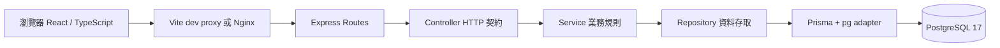
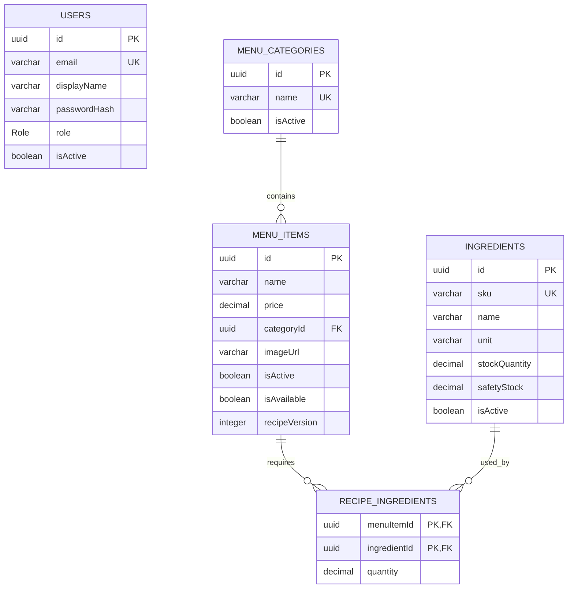

# v0.4.0 Windows單店整合架構（2026-11-12）

## 最終交接補充

完整24表及21項實際FK關聯見ERD；前後端領域模組與現有分層界線見HANDOFF_ARCHITECTURE。scripts/acceptance提供專用第三個PostgreSQL、真實HTTP營運檢查、資料指紋與原開發帳號／資料不變驗證，並真正重啟隔離DB與API。

沿用原框架與Session／CSRF。新增17張表：BundlePart、OptionGroup、MenuOption、OptionRecipe、CommandReceipt、StockMovement、Order、OrderLine、Supplier、Purchase、PurchaseLine、GoodsReceipt、Job、Employee、Shift、Attendance、Leave；前3版Migration不變，第4版只新增結構並為既有庫存留基準。

operations/routes處理HTTP契約、驗證與RBAC；各service處理領域邏輯，repository統一真實Prisma交易、操作者重驗、共享DB鎖與冪等。其他模組沿用目錄的同一鎖，因此改單位／配方與下單不會讀到部分版本。開始製作、收貨與盤點的數量、狀態、流水及命令結果原子提交。報表使用RepeatableRead＋READ ONLY。前端api/operations集中Fetch，operations-ui共用表單／分頁／錯誤與重試；pages/operations及menu-configuration提供真實操作。

快照JSON含不可變價格、分類與食材Decimal字串及unit，不只留可變FK。OrderLine另存Decimal金額。使用JSON避免複雜選項快照重建，但不允許API修改；後續版本改JSON形狀須向後相容。所有營運主檔採停用，流水與歷史訂單無刪改API。

角色、取消／扣庫／收貨／排班與報表規則見 [OPERATIONS-DECISIONS](OPERATIONS-DECISIONS.md)。單店共享鎖取捨適用課程展示，並非高流量多店方案。正式附件未取得。以下保留過往設計紀錄；「未實作」是該階段歷史狀態。

# 系統架構與設計決策

更新日期：2026-11-10（Asia/Taipei）｜階段：02B｜版本：0.3.0

## 依據與範圍

開始時工作目錄沒有程式碼、Git 儲存庫或附件。本版僅以使用者提供的七大模組、指定技術與第一階段要求為依據。尚未閱讀任何未提供的簡報、功能分解圖、ERD 或其他需求附件。

保留第一階段架構與第二階段 A 的登入／Session／CSRF／RBAC。第二階段 B 提供食材、分類、一般餐點與配方管理；庫存唯讀。訂單、庫存流水、採購、排班與報表未開發。正式附件仍未取得，決策見 PHASE2A-DECISIONS 與 PHASE2B-DECISIONS。

## 執行架構

- 前端使用 React Router，API 呼叫集中於 `src/api`。Zod 驗證回應契約；Fetch 設 8 秒 timeout，卸載與重試會取消舊請求，避免舊結果覆蓋新結果。
- 後端 `createApp()` 不直接 listen，可注入 HealthRepository 供測試。`server.ts` 負責程序與 graceful shutdown。
- Routes 註冊端點；Controller 處理 HTTP 成功回應；Service 決定健康／不可用語意；Repository 執行 Prisma 真實查詢。
- Express 5 將 async handler 的 rejection 交給統一 error middleware，不需要額外 async wrapper 套件。
- `DATABASE_URL`、CORS 等設定在啟動時驗證。dotenv 由檔案位置定位根目錄 `.env`，不依賴執行命令時的目錄；外部環境變數優先。
- Prisma 7 使用 `prisma.config.ts` 配置 CLI URL，runtime 使用 `@prisma/adapter-pg`；產生的 client 不入 Git，安裝後需明確執行 generate。
- Tailwind 4 使用官方 Vite plugin 與 CSS import。沒有更換使用者指定的核心技術。

## 核心資料模型（含第二階段 B 補充）

- 初始 Migration：`20261110000100_initial_core`，包含五張業務基礎資料表與 Role enum；Prisma 自行維護 `_prisma_migrations`。
- Role：ADMIN 管理員、MANAGER 店長、CASHIER 櫃檯、KITCHEN 廚房。四種角色均可登入，僅 ADMIN 可管理帳號。
- UUID 由 Prisma 產生。`@updatedAt` 也由 Prisma 維護，直接 SQL 寫入須提供這些欄位。
- 金額 NUMERIC(12,2)、數量 NUMERIC(14,3)；現行 API 請求／回應均採明確十進位字串，Prisma.Decimal 計算與比較，不用 JS 浮點數。回應金額固定 2 位、數量固定 3 位。
- 食材固定基礎單位，PUT 配方逐列明確驗 unit 完全相同，不做換算。有任何配方關聯或非零庫存時不允許改單位。
- CHECK 約束：庫存與安全庫存 ≥ 0，售價 ≥ 0，配方用量 > 0。
- 餐點＋食材複合主鍵避免配方重複；SKU、分類名稱、email 有唯一索引。Email 由驗證層轉小寫，新增 lower(email) unique index。
- 關聯採 Restrict，避免刪除分類、餐點或食材時連帶刪除其他資料；營運資料優先停用。
- 訂單、庫存異動、採購與員工排班資料表留到對應階段，避免先固定尚未確認的完整 ERD。
- 健康檢查只證明 PostgreSQL 可執行 `SELECT 1`，不驗證 migration 狀態；部署須先 `migrate deploy`，並用 `db:status` 確認版本。

## HTTP 與安全基礎

- API 前綴 `/api`，JSON，成功與失敗皆有 requestId；OpenAPI 規格與 Swagger UI 另有文件端點。
- 每次請求由伺服器產生 UUID，回傳 `X-Request-ID`，不信任外部任意傳入的 ID。
- Helmet、禁止 x-powered-by、JSON 100 KB 上限、明確 CORS origin、API no-store。
- 500 類錯誤不把 stack、SQL、URL、密碼回傳前端。日誌僅記 level、code、requestId；下一階段再補必要的安全稽核內容。
- CORS 是瀏覽器政策，不能代替身份驗證。只有 health／文件／Session bootstrap 公開；users 由伺服器驗證 Session 與 ADMIN，寫入另驗 CSRF。
- 開發資料庫與 API 預設只綁本機。容器內 API 綁 0.0.0.0，但 host port 仍只暴露於 127.0.0.1。
- 密碼使用 Argon2id，Session 使用 PostgreSQL 與 HttpOnly Cookie，具 CSRF、登入限流與後端 RBAC。實際契約見 API.md。

## 第二階段 A：驗證與授權

前端 api/client 集中處理 credentials、CSRF 與 401；auth-provider 管理登入狀態，auth-context 提供共享 context，ProtectedRoute 擋未登入與非授權角色。CSRF 只存記憶體，不以 localStorage 儲存 bearer token。路由與 sidebar 依角色顯示，後端仍獨立驗權。首頁保留真實 health，不放假營收。

後端 auth 與 users 仍採 Routes → Controller → Service → Repository。loadSession 每次從 DB 取得 Session 與 User，檢查到期、閒置、isActive 與 authVersion；requireAuthenticated／requireRoles 統一拒絕 401／403；protectCsrf 驗完整 Origin、同步 token 及 JSON，包含登入與登出。

新 Migration `20261110000200_auth_sessions` 是加法遷移：新增 users.authVersion、sessions、auth_rate_limits、索引及兩個 CHECK。初始 migration 未修改。套用前檢查忽略大小寫的 Email 重複；若未來既有資料有衝突，需人工處理，不自動合併或刪資料。

sessions.id 為 raw token 的 SHA-256，userId／authVersion 為可空配對（匿名 Session）；csrfToken 供同步 token 檢查，createdAt、lastSeenAt、expiresAt 管理期限。User 一對多 Session，User 刪除時連帶清 Session，但應用沒有刪 User API。auth_rate_limits 只存雜湊範圍 key、count、resetAt，不存原始 IP／Email。

登入交易先鎖 User、重查 active／version／passwordHash，再鎖並刪舊 Session、建立新 Session，防止重送及驗證後停用的競爭。所有使用者管理寫入採 advisory transaction lock，再鎖操作者／目標、重驗 ADMIN。停用及敏感欄位變更在同一交易遞增版本與刪除全部 Session。禁止自停用／降權並保留最後管理員。

預設閒置 30 分鐘、絕對 8 小時；匿名 20 分鐘。登入成功與失敗皆持久化限流：IP 30、帳號 10 次／15 分鐘。新匿名 Session 為 IP 60 次／分鐘。過期列清理、登入事件稽核與正式 HTTPS／容量監控仍屬營運準備事項。

本機 Cookie 可在 loopback HTTP 使用非 Secure；正式域名強制 Secure + HTTPS，採 __Host- Cookie、HttpOnly、SameSite=Lax、Path=/、無 Domain。production 只信任 APP_ORIGIN；開發另外接受 CORS_ORIGIN。直連 trust proxy=0；Compose Nginx 單代理=1 且覆寫 forwarded IP，正式需隔離 API 直連。

bootstrap 工具只在開發環境建立首位管理員，互動隱藏密碼或程序環境注入，不固定 seed、不覆寫既有帳號。密碼參數與來源依據見 PHASE2A-DECISIONS。

## 第二階段 B：目錄與配方架構

前端 api/catalog 集中 Zod 契約與 CRUD／PUT；Ingredients、Categories、MenuItems 與 RecipeEditor 使用真正 Fetch。useCatalogList 取消過期請求，統一 Loading／Empty／Error／重試。分類選項以 pageSize=100 逐頁讀取完整結果，沒有默默只取前 100 筆；配方食材選擇可搜尋與分頁。Dialog 中用量保留字串，基礎單位不可任意輸入替換。

後端 modules/catalog 延續 Routes → Controller → Service → Repository。Routes 沿用 AuthService.loadSession、requireAuthenticated、requireRoles 與 protectCsrf；Service 明確序列化 Decimal DTO；Repository 管理真實查詢及交易。Catalog 寫入再鎖 User 並核對啟用、authVersion 與角色，防止 request 通過 middleware 後操作者才被撤銷。

第三版 Migration 20261110000300_catalog_management 只新增 MenuCategory.isActive、MenuItem.recipeVersion 與 SQL 約束／索引，沿用原 Ingredient／MenuCategory／MenuItem／RecipeIngredient，不重建、不清空。套用前查 normalized SKU／分類重複，有衝突就停止供人工處理，不刪改資料。前兩版 Migration 不變。

SKU trim／大寫，分類名稱 trim；lower(btrim(...)) functional unique indexes 防大小寫與空白重複。既有 Restrict FK 及配方複合主鍵仍有效。分類、食材、餐點只停用，無硬刪除 API。

庫存 stockQuantity 僅可讀，POST／PATCH strict DTO 拒絕此欄位；新食材為 DB 預設零。無期初庫存／領料／調整／扣庫功能，也沒有無流水的寫入捷徑。安全庫存可以維護，警戒狀態以 Decimal <= 比較。

配方 GET 採 Repeatable Read，version 與用量一致。PUT expectedVersion + 完整 items 集合，在同一交易驗權／狀態／unit／重複，再 deleteMany、createMany 與遞增版本；失敗全 rollback。當前單店 catalog 所有管理寫入以 advisory transaction lock 12002002 串行，避免變更單位／停用與配方互相競爭；未來高流量可改細粒度鎖，但保留版本與原子性。兩個相同舊版本的更新不能互相覆蓋。

配方停用保留政策、數量界線、角色草案差異見 PHASE2B-DECISIONS。未建立訂單快照表；未來依原子讀取的 recipeVersion、食材名稱／SKU／unit／用量建立獨立不可變 OrderItemRecipeSnapshot，詳見 NEXT_ORDER_INVENTORY。

依使用者明確授權，KITCHEN 可 GET 食材庫存、安全庫存與低庫存篩選，但所有非讀取方法經後端管理角色 guard。庫存 DTO 採白名單，不回傳採購價或供應商資料。足夠性查詢以 Repeatable Read + READ ONLY 交易，依當前配方與 Decimal 庫存算 1–10000 份需求，不改庫存、配方或訂單，不代表預留。CASHIER 只有菜單讀取，無庫存／足夠性權。

## 下一階段訂單與庫存規則草案（尚未實作）

以下規則是技術建議，需團隊確認後實作並測試：

1. 訂單狀態：PENDING → PREPARING → COMPLETED；PENDING／PREPARING 可轉 CANCELLED；COMPLETED／CANCELLED 不可再轉狀態。退款與退貨不在現階段範圍。
2. 建立訂單時保存餐點名稱、單價、配方快照，後端計算小計／折扣／服務費／總額；不採信前端總額。幣別先規劃 TWD，但小數位與四捨五入規則待確認。
3. 建議在 PENDING → PREPARING 時扣庫；PENDING 不預留庫存，開始製作才確認有貨。若團隊要求下單即預留，需另加 reservation 模型。
4. 扣庫與狀態變更放在同一筆 PostgreSQL 交易；按 ingredient ID 固定順序處理，使用條件 UPDATE（stock ≥ required）或 row lock。任一食材不足時整筆 rollback，回傳 409 INSUFFICIENT_STOCK。
5. 訂單 create 與狀態轉換使用 Idempotency-Key。建立持久化唯一鍵與 payload hash；同 key 同 payload 回傳原結果，同 key 不同 payload 回 409。併發請求不能只靠記憶體鎖。
6. 以訂單／庫存事件唯一約束確保同一訂單只有一組扣庫紀錄；資料庫條件狀態轉換與交易避免重複扣除。Serializable 衝突或 deadlock 需有有限次重試。
7. PENDING 取消不回庫；PREPARING 取消預設記錄已耗用食材，不自動回庫，避免已製作食物被當成可用原料。若實際可回收，由授權人員建立可稽核的補償異動；此政策待確認。
8. StockMovement 為不可隨意修改的異動流水，包含 signed quantity、before/after、原因、操作者、訂單／收貨來源與時間；期初、進貨、領料、耗損與盤點皆透過交易寫流水。
9. 收貨增加庫存與 PurchaseOrder／Receipt 狀態同一交易完成，依 receipt 唯一鍵去重，支援部分收貨與否待確認。
10. 銷售報表依 COMPLETED 訂單與營業日計算；排除取消單，使用 Asia/Taipei 的日期邊界轉 UTC 查詢。付款完成與製作完成是否分離，需需求確認。

## 現行角色權限與後續草案

| 功能                   | 管理員   | 店長     | 櫃檯   | 廚房 |
| ---------------------- | -------- | -------- | ------ | ---- |
| 使用者／角色管理       | 完整     | 無       | 無     | 無   |
| 食材基礎資料／唯讀庫存 | 管理     | 管理     | 無     | 唯讀 |
| 分類／一般餐點         | 管理     | 管理     | 查詢   | 查詢 |
| 配方                   | 管理     | 管理     | 無     | 查詢 |
| 庫存數量調整           | 尚未開發 | 尚未開發 | 無     | 無   |
| 建立訂單／付款紀錄     | 完整     | 完整     | 允許   | 無   |
| 更新製作狀態           | 完整     | 完整     | 待確認 | 允許 |
| 採購／員工／報表       | 完整     | 依功能   | 無     | 無   |

每個受保護 API 都必須後端驗權；前端隱藏選單只改善操作體驗。停用帳號須撤銷 session，不能只拒絕新登入。

## 測試與交付邊界

- 一般測試：原 Health／migration 完整性與 Dashboard 測試，新增 Argon2id、Cookie、CSRF、RBAC、到期、限流、前端登入與使用者表單；fixture 僅用於測試。
- 整合測試：隔離 PostgreSQL 上套用真實 migration，測 API 真實連線、Decimal 精度、配方關聯、交易 rollback、CHECK 約束；沒有實作或驗證未開發的訂單扣庫流程。
- CI：Ubuntu + Node 24 + 隔離 PostgreSQL 17 容器；每次執行產生隨機資料庫密碼並遮蔽日誌，測試後停止該一次性容器。工作流程尚未遠端執行，本機不會觸發 push。
- Docker：開發 DB named volume，測試 DB tmpfs，app profile 包含 migrate → API → Nginx。開發與測試不共用資料庫。
- 目前無 Git remote、無 push、無遠端部署。Docker 引擎的環境限制與實測範圍見 PROGRESS。

驗收工具 npm run db 唯讀比較實際 Schema、所有已套用 checksum、7 項 CHECK 及 3 個 functional unique indexes（Email／SKU／分類）。從 PostgreSQL catalog 驗證表名、定義、validated／unique／valid 狀態，補 Prisma Schema 無法表示的 SQL 約束。工具不建 shadow DB、不改既有 SQL、不 reset；差異或連線失敗回非零 exit code。原第一階段四約束檢查與測試保留。

## 待取得或確認

- 正式簡報、功能分解圖、ERD、需求文件與課程評分標準。
- 單店或多店；本版暫以單店規劃，未加入 tenant／branch。
- 登入暫沿用 Email；ADMIN 管理權、12–128 字元密碼與預設 Session 時限已實作，正式文件到齊後再核對政策；店長擴權尚未授予。
- 庫存扣減時機、製作後取消政策、食材單位與換算、是否允許負庫存。
- 折扣／服務費／稅額／TWD 小數位、營業日跨午夜與付款時點。
- 套餐／客製化是否影響配方與價差；圖片採 URL 或上傳儲存。
- 訂單編號規則、外送訂單欄位；僅紀錄，不串接外送平台或真實金流。
- 供應商與收貨流程、排班衝突、請假審核、個資保留與報表欄位。

本專案不增加金流、外送平台即時 API、薪資／報稅、總帳、POS 硬體、AI 預測等排除範圍。

## 官方技術參考

- [Prisma 7 PostgreSQL 與 pg adapter](https://www.prisma.io/docs/orm/v7/core-concepts/supported-databases/postgresql)
- [Tailwind CSS Vite 整合](https://tailwindcss.com/docs/installation/using-vite)
- [Vitest 測試專案設定](https://main.vitest.dev/guide/projects)
