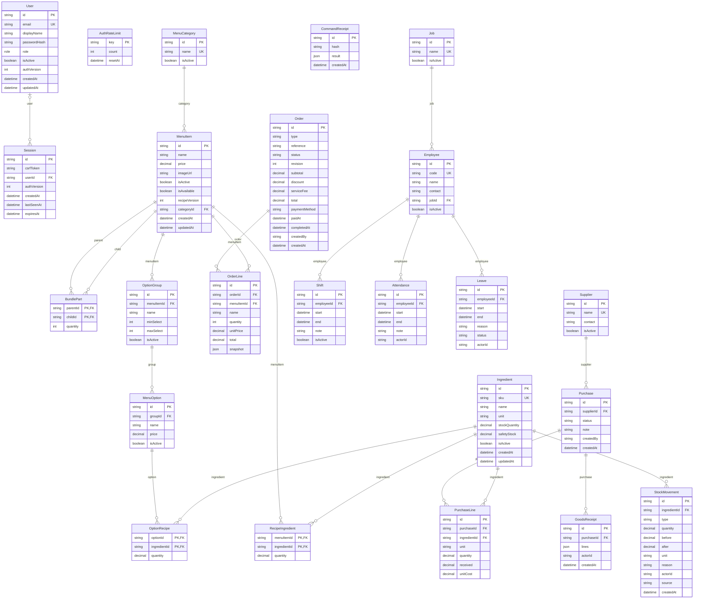

# 完整 ERD 與資料表字典（v0.4.0）

依實際 Prisma Schema 與四版 Migration 產生，共 **24 張應用資料表**；另有 Prisma 自管 _prisma_migrations。SQL約束與實際結構透過 npm run db 驗證。本文件只含結構，不含帳密或實際個資。

以下實線為實際FK。createdBy、actorId及CommandReceipt鍵內的actor為邏輯稽核識別，現行Schema沒有FK；不能把它們誤認為資料庫已強制的關聯。User只有停用API，因此應用不會刪除稽核操作者。Session.userId可空（匿名Session）。

## 資料型別及約束

Decimal數量NUMERIC(14,3)，金額NUMERIC(12,2)，API字串；時間timestamptz(3)儲存UTC、報表採台北日界。單位是食材基礎單位，無自動換算。Restrict外鍵保留業務歷史；Session.user外鍵採Cascade，應用不提供刪使用者API。

19項CHECK：原庫存／安全量／售價／配方、Session配對／限流正數／配方版本，以及套餐份數、選項上下限／價格／用量、流水平衡、訂單金額／狀態、明細金額、採購數量、班表／出勤／請假區間。SQL功能索引處理lower email／SKU／分類；attendance_single_open限定每員工一筆未下班。Schema無法表達的CHECK／功能索引保留於Migration。

OrderLine.snapshot含歷史價格、分類、組件、選項及食材用量；CommandReceipt.result與GoodsReceipt.lines為持久化JSON。前者不可由API改寫，後者配合強型別來源欄位校驗及交易。StockMovement保存前後量與來源，所有應用庫存寫入都經此流水。

## User → users

| 欄位         | Prisma型別 | 可空 | 索引／實體設定                     |
| ------------ | ---------- | ---- | ---------------------------------- |
| id           | String     | 否   | PK @id @default(uuid()) @db.Uuid   |
| email        | String     | 否   | UK @unique @db.VarChar(254)        |
| displayName  | String     | 否   | @db.VarChar(100)                   |
| passwordHash | String     | 否   | @db.VarChar(255)                   |
| role         | Role       | 否   |                                    |
| isActive     | Boolean    | 否   | @default(true)                     |
| authVersion  | Int        | 否   | @default(0)                        |
| createdAt    | DateTime   | 否   | @default(now()) @db.Timestamptz(3) |
| updatedAt    | DateTime   | 否   | @updatedAt @db.Timestamptz(3)      |

## Session → sessions

| 欄位        | Prisma型別 | 可空 | 索引／實體設定                     |
| ----------- | ---------- | ---- | ---------------------------------- |
| id          | String     | 否   | PK @id @db.Char(64)                |
| csrfToken   | String     | 否   | @db.VarChar(64)                    |
| userId      | String     | 是   | FK @db.Uuid                        |
| authVersion | Int        | 是   |                                    |
| createdAt   | DateTime   | 否   | @default(now()) @db.Timestamptz(3) |
| lastSeenAt  | DateTime   | 否   | @db.Timestamptz(3)                 |
| expiresAt   | DateTime   | 否   | @db.Timestamptz(3)                 |

複合設定：@@index([userId])

複合設定：@@index([expiresAt])

## AuthRateLimit → auth_rate_limits

| 欄位    | Prisma型別 | 可空 | 索引／實體設定      |
| ------- | ---------- | ---- | ------------------- |
| key     | String     | 否   | PK @id @db.Char(64) |
| count   | Int        | 否   |                     |
| resetAt | DateTime   | 否   | @db.Timestamptz(3)  |

複合設定：@@index([resetAt])

## Ingredient → ingredients

| 欄位          | Prisma型別 | 可空 | 索引／實體設定                     |
| ------------- | ---------- | ---- | ---------------------------------- |
| id            | String     | 否   | PK @id @default(uuid()) @db.Uuid   |
| sku           | String     | 否   | UK @unique @db.VarChar(64)         |
| name          | String     | 否   | @db.VarChar(100)                   |
| unit          | String     | 否   | @db.VarChar(20)                    |
| stockQuantity | Decimal    | 否   | @default(0) @db.Decimal(14, 3)     |
| safetyStock   | Decimal    | 否   | @default(0) @db.Decimal(14, 3)     |
| isActive      | Boolean    | 否   | @default(true)                     |
| createdAt     | DateTime   | 否   | @default(now()) @db.Timestamptz(3) |
| updatedAt     | DateTime   | 否   | @updatedAt @db.Timestamptz(3)      |

## MenuCategory → menu_categories

| 欄位     | Prisma型別 | 可空 | 索引／實體設定                   |
| -------- | ---------- | ---- | -------------------------------- |
| id       | String     | 否   | PK @id @default(uuid()) @db.Uuid |
| name     | String     | 否   | UK @unique @db.VarChar(100)      |
| isActive | Boolean    | 否   | @default(true)                   |

## MenuItem → menu_items

| 欄位          | Prisma型別 | 可空 | 索引／實體設定                     |
| ------------- | ---------- | ---- | ---------------------------------- |
| id            | String     | 否   | PK @id @default(uuid()) @db.Uuid   |
| name          | String     | 否   | @db.VarChar(100)                   |
| price         | Decimal    | 否   | @db.Decimal(12, 2)                 |
| imageUrl      | String     | 是   | @db.VarChar(2048)                  |
| isActive      | Boolean    | 否   | @default(true)                     |
| isAvailable   | Boolean    | 否   | @default(true)                     |
| recipeVersion | Int        | 否   | @default(0)                        |
| categoryId    | String     | 否   | FK @db.Uuid                        |
| createdAt     | DateTime   | 否   | @default(now()) @db.Timestamptz(3) |
| updatedAt     | DateTime   | 否   | @updatedAt @db.Timestamptz(3)      |

複合設定：@@index([categoryId])

## BundlePart → bundle_parts

| 欄位     | Prisma型別 | 可空 | 索引／實體設定  |
| -------- | ---------- | ---- | --------------- |
| parentId | String     | 否   | PK, FK @db.Uuid |
| childId  | String     | 否   | PK, FK @db.Uuid |
| quantity | Int        | 否   |                 |

複合設定：@@id([parentId,childId])

## OptionGroup → option_groups

| 欄位       | Prisma型別 | 可空 | 索引／實體設定                   |
| ---------- | ---------- | ---- | -------------------------------- |
| id         | String     | 否   | PK @id @default(uuid()) @db.Uuid |
| menuItemId | String     | 否   | FK @db.Uuid                      |
| name       | String     | 否   | @db.VarChar(100)                 |
| minSelect  | Int        | 否   | @default(0)                      |
| maxSelect  | Int        | 否   | @default(1)                      |
| isActive   | Boolean    | 否   | @default(true)                   |

## MenuOption → menu_options

| 欄位     | Prisma型別 | 可空 | 索引／實體設定                   |
| -------- | ---------- | ---- | -------------------------------- |
| id       | String     | 否   | PK @id @default(uuid()) @db.Uuid |
| groupId  | String     | 否   | FK @db.Uuid                      |
| name     | String     | 否   | @db.VarChar(100)                 |
| price    | Decimal    | 否   | @db.Decimal(12,2)                |
| isActive | Boolean    | 否   | @default(true)                   |

## OptionRecipe → option_recipes

| 欄位         | Prisma型別 | 可空 | 索引／實體設定    |
| ------------ | ---------- | ---- | ----------------- |
| optionId     | String     | 否   | PK, FK @db.Uuid   |
| ingredientId | String     | 否   | PK, FK @db.Uuid   |
| quantity     | Decimal    | 否   | @db.Decimal(14,3) |

複合設定：@@id([optionId,ingredientId])

## CommandReceipt → command_receipts

| 欄位      | Prisma型別 | 可空 | 索引／實體設定                     |
| --------- | ---------- | ---- | ---------------------------------- |
| id        | String     | 否   | PK @id @db.VarChar(180)            |
| hash      | String     | 否   | @db.Char(64)                       |
| result    | Json       | 否   |                                    |
| createdAt | DateTime   | 否   | @default(now()) @db.Timestamptz(3) |

## StockMovement → stock_movements

| 欄位         | Prisma型別 | 可空 | 索引／實體設定                     |
| ------------ | ---------- | ---- | ---------------------------------- |
| id           | String     | 否   | PK @id @default(uuid()) @db.Uuid   |
| ingredientId | String     | 否   | FK @db.Uuid                        |
| type         | String     | 否   | @db.VarChar(30)                    |
| quantity     | Decimal    | 否   | @db.Decimal(14,3)                  |
| before       | Decimal    | 否   | @db.Decimal(14,3)                  |
| after        | Decimal    | 否   | @db.Decimal(14,3)                  |
| unit         | String     | 否   | @db.VarChar(20)                    |
| reason       | String     | 否   | @db.VarChar(500)                   |
| actorId      | String     | 是   | @db.Uuid                           |
| source       | String     | 否   | @db.VarChar(180)                   |
| createdAt    | DateTime   | 否   | @default(now()) @db.Timestamptz(3) |

複合設定：@@unique([source,ingredientId])

複合設定：@@index([ingredientId,createdAt])

## Order → orders

| 欄位          | Prisma型別 | 可空 | 索引／實體設定                      |
| ------------- | ---------- | ---- | ----------------------------------- |
| id            | String     | 否   | PK @id @default(uuid()) @db.Uuid    |
| type          | String     | 否   | @db.VarChar(20)                     |
| reference     | String     | 否   | @db.VarChar(200)                    |
| status        | String     | 否   | @default("PENDING") @db.VarChar(20) |
| revision      | Int        | 否   | @default(0)                         |
| subtotal      | Decimal    | 否   | @db.Decimal(12,2)                   |
| discount      | Decimal    | 否   | @db.Decimal(12,2)                   |
| serviceFee    | Decimal    | 否   | @db.Decimal(12,2)                   |
| total         | Decimal    | 否   | @db.Decimal(12,2)                   |
| paymentMethod | String     | 是   | @db.VarChar(20)                     |
| paidAt        | DateTime   | 是   | @db.Timestamptz(3)                  |
| completedAt   | DateTime   | 是   | @db.Timestamptz(3)                  |
| createdBy     | String     | 否   | @db.Uuid                            |
| createdAt     | DateTime   | 否   | @default(now()) @db.Timestamptz(3)  |

複合設定：@@index([createdAt,status])

## OrderLine → order_lines

| 欄位       | Prisma型別 | 可空 | 索引／實體設定                   |
| ---------- | ---------- | ---- | -------------------------------- |
| id         | String     | 否   | PK @id @default(uuid()) @db.Uuid |
| orderId    | String     | 否   | FK @db.Uuid                      |
| menuItemId | String     | 否   | FK @db.Uuid                      |
| name       | String     | 否   | @db.VarChar(100)                 |
| quantity   | Int        | 否   |                                  |
| unitPrice  | Decimal    | 否   | @db.Decimal(12,2)                |
| total      | Decimal    | 否   | @db.Decimal(12,2)                |
| snapshot   | Json       | 否   |                                  |

複合設定：@@index([orderId])

## Supplier → suppliers

| 欄位     | Prisma型別 | 可空 | 索引／實體設定                   |
| -------- | ---------- | ---- | -------------------------------- |
| id       | String     | 否   | PK @id @default(uuid()) @db.Uuid |
| name     | String     | 否   | UK @unique @db.VarChar(100)      |
| contact  | String     | 否   | @db.VarChar(200)                 |
| isActive | Boolean    | 否   | @default(true)                   |

## Purchase → purchases

| 欄位       | Prisma型別 | 可空 | 索引／實體設定                        |
| ---------- | ---------- | ---- | ------------------------------------- |
| id         | String     | 否   | PK @id @default(uuid()) @db.Uuid      |
| supplierId | String     | 否   | FK @db.Uuid                           |
| status     | String     | 否   | @default("REQUESTED") @db.VarChar(20) |
| note       | String     | 否   | @db.VarChar(500)                      |
| createdBy  | String     | 否   | @db.Uuid                              |
| createdAt  | DateTime   | 否   | @default(now()) @db.Timestamptz(3)    |

## PurchaseLine → purchase_lines

| 欄位         | Prisma型別 | 可空 | 索引／實體設定                   |
| ------------ | ---------- | ---- | -------------------------------- |
| id           | String     | 否   | PK @id @default(uuid()) @db.Uuid |
| purchaseId   | String     | 否   | FK @db.Uuid                      |
| ingredientId | String     | 否   | FK @db.Uuid                      |
| unit         | String     | 否   | @db.VarChar(20)                  |
| quantity     | Decimal    | 否   | @db.Decimal(14,3)                |
| received     | Decimal    | 否   | @default(0) @db.Decimal(14,3)    |
| unitCost     | Decimal    | 否   | @db.Decimal(12,2)                |

複合設定：@@unique([purchaseId,ingredientId])

## GoodsReceipt → goods_receipts

| 欄位       | Prisma型別 | 可空 | 索引／實體設定                     |
| ---------- | ---------- | ---- | ---------------------------------- |
| id         | String     | 否   | PK @id @default(uuid()) @db.Uuid   |
| purchaseId | String     | 否   | FK @db.Uuid                        |
| lines      | Json       | 否   |                                    |
| actorId    | String     | 否   | @db.Uuid                           |
| createdAt  | DateTime   | 否   | @default(now()) @db.Timestamptz(3) |

## Job → jobs

| 欄位     | Prisma型別 | 可空 | 索引／實體設定                   |
| -------- | ---------- | ---- | -------------------------------- |
| id       | String     | 否   | PK @id @default(uuid()) @db.Uuid |
| name     | String     | 否   | UK @unique @db.VarChar(100)      |
| isActive | Boolean    | 否   | @default(true)                   |

## Employee → employees

| 欄位     | Prisma型別 | 可空 | 索引／實體設定                   |
| -------- | ---------- | ---- | -------------------------------- |
| id       | String     | 否   | PK @id @default(uuid()) @db.Uuid |
| code     | String     | 否   | UK @unique @db.VarChar(64)       |
| name     | String     | 否   | @db.VarChar(100)                 |
| contact  | String     | 否   | @db.VarChar(200)                 |
| jobId    | String     | 否   | FK @db.Uuid                      |
| isActive | Boolean    | 否   | @default(true)                   |

## Shift → shifts

| 欄位       | Prisma型別 | 可空 | 索引／實體設定                   |
| ---------- | ---------- | ---- | -------------------------------- |
| id         | String     | 否   | PK @id @default(uuid()) @db.Uuid |
| employeeId | String     | 否   | FK @db.Uuid                      |
| start      | DateTime   | 否   | @db.Timestamptz(3)               |
| end        | DateTime   | 否   | @db.Timestamptz(3)               |
| note       | String     | 否   | @db.VarChar(500)                 |
| isActive   | Boolean    | 否   | @default(true)                   |

複合設定：@@index([employeeId,start,end])

## Attendance → attendance

| 欄位       | Prisma型別 | 可空 | 索引／實體設定                   |
| ---------- | ---------- | ---- | -------------------------------- |
| id         | String     | 否   | PK @id @default(uuid()) @db.Uuid |
| employeeId | String     | 否   | FK @db.Uuid                      |
| start      | DateTime   | 否   | @db.Timestamptz(3)               |
| end        | DateTime   | 是   | @db.Timestamptz(3)               |
| note       | String     | 否   | @db.VarChar(500)                 |
| actorId    | String     | 否   | @db.Uuid                         |

## Leave → leaves

| 欄位       | Prisma型別 | 可空 | 索引／實體設定                        |
| ---------- | ---------- | ---- | ------------------------------------- |
| id         | String     | 否   | PK @id @default(uuid()) @db.Uuid      |
| employeeId | String     | 否   | FK @db.Uuid                           |
| start      | DateTime   | 否   | @db.Timestamptz(3)                    |
| end        | DateTime   | 否   | @db.Timestamptz(3)                    |
| reason     | String     | 否   | @db.VarChar(500)                      |
| status     | String     | 否   | @default("REQUESTED") @db.VarChar(20) |
| actorId    | String     | 否   | @db.Uuid                              |

## RecipeIngredient → recipe_ingredients

| 欄位         | Prisma型別 | 可空 | 索引／實體設定     |
| ------------ | ---------- | ---- | ------------------ |
| menuItemId   | String     | 否   | PK, FK @db.Uuid    |
| ingredientId | String     | 否   | PK, FK @db.Uuid    |
| quantity     | Decimal    | 否   | @db.Decimal(14, 3) |

複合設定：@@id([menuItemId, ingredientId])

複合設定：@@index([ingredientId])
