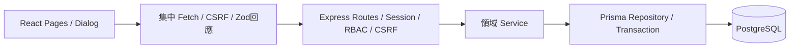

# 前後端模組與資料流程交接

| 範圍     | 前端                                                          | 後端／資料存取                                                             |
| -------- | ------------------------------------------------------------- | -------------------------------------------------------------------------- |
| 登入帳號 | auth/、api/auth、pages/login/users                            | modules/auth、users；AuthRepository統一登入與撤權交易                      |
| 食材菜單 | pages/ingredients/menu-*、recipe-editor、api/catalog          | modules/catalog Routes→Controller→Service→Repository                       |
| 套餐選項 | pages/menu-configuration                                      | operations/menu.service、BundlePart／OptionGroup／MenuOption／OptionRecipe |
| 訂單     | pages/operations/orders                                       | operations/orders.service、Order／OrderLine快照                            |
| 庫存     | pages/operations/inventory                                    | inventory.service及repository.move；所有數量寫入留流水                     |
| 採購     | pages/operations/purchasing                                   | purchasing.service，GoodsReceipt與入庫同交易                               |
| 人事     | pages/operations/staff                                        | staff.service，半開區間衝突與核准                                          |
| 報表     | pages/operations/reports                                      | reports.service，RepeatableRead＋READ ONLY                                 |
| 共用     | components/operations-ui、pages/operations/shared、api/client | operations/routes、validation、repository、統一ApiError                    |

operations/routes目前同時承擔HTTP Controller與部分清單讀取的Prisma存取，領域service也直接使用transaction client。不是每個領域都有獨立repository類別；後續可逐一抽出read repository，但不可改動共同交易邊界、角色或回應契約。這是現況說明，不把理想分層當作已完成。

共用write先取得PostgreSQL advisory transaction lock，再鎖操作者並重驗active／authVersion／role；同交易處理命令hash、結果快取、業務寫入。catalog與operations共用同一鎖，避免單位／配方與下單讀到部分版本。此取捨適合低流量單店，未作高負載驗證。

開始製作使用OrderLine不可變配方快照，彙總食材後固定順序扣庫、寫StockMovement並改狀態。收貨先檢查採購狀態及每列餘量，建立GoodsReceipt、加庫、更新received與PARTIAL／RECEIVED，任一錯誤全回滾。並非先回成功再背景補資料。

一般Vitest測試與真實PostgreSQL測試分開；新test:acceptance是獨立HTTP服務加專用第三個PostgreSQL執行個體，不把開發資料庫當測試庫。ERD見ERD.md，API／權限見OPERATIONS-API及OPERATIONS-DECISIONS。
